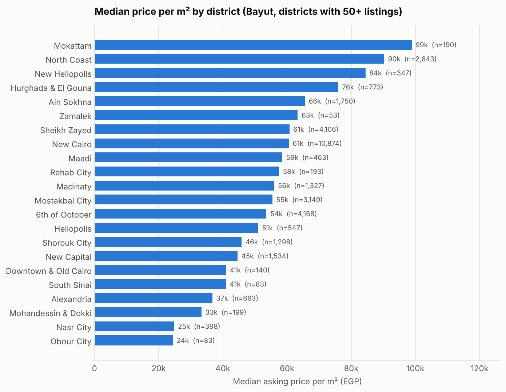
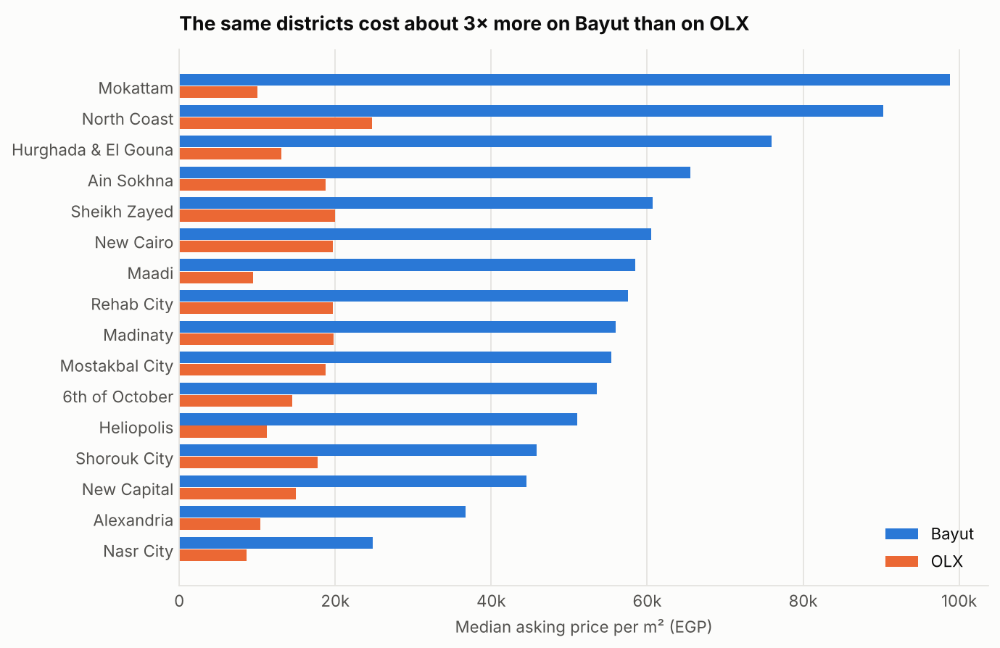
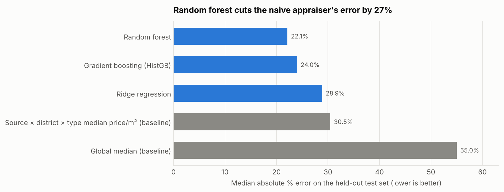

# In-Depth Analysis of Real Estate Market Trends in Egypt

An end-to-end data science project on Egypt's housing market. It merges three listing datasets
(about 89k raw listings), standardizes locations across sources, removes duplicate listings, explores
price drivers, benchmarks price-prediction models against baselines, and ends with an explainable
property recommender.



## Highlights

| | |
|---|---|
| **Clean data** | 88,779 raw rows → **62,340 unique listings**, with every cleaning rule's effect logged |
| **Locations** | 1,884 raw location spellings → **35 districts in 7 regions** (99.7% matched) |
| **Best model** | Random forest: **median error 22%**, R² 0.75 on log price, 27% lower error than a strong naive baseline |
| **Recommender** | Hard-rule filtering plus value ranking from out-of-fold fair prices, with a plain-language reason for every pick |

## Key findings

1. **Sources can't be pooled naively.** For the same districts, Bayut asking prices per m² are about
   **3.3× OLX's**. Bayut is the more recent snapshot (after the 2022–2024 devaluation of the pound)
   and is dominated by new compounds. The analysis treats sources separately, and the model learns
   the difference through a `source` feature.
2. **Location sets the price level.** On Bayut, the median price per m² ranges from about EGP 25k
   (Nasr City) to more than EGP 90k (North Coast, Mokattam). New Cairo and Sheikh Zayed sit at about
   EGP 61k.
3. **Resort chalets are the most expensive homes per m²** (about EGP 75k), and villas and townhouses
   cost 30–40% more per m² than apartments.
4. **Price scales almost linearly with area** (elasticity 0.90). Bedrooms add little once area is
   known.
5. **Districts fall into three segments:** resort and compact premium markets, villa-heavy
   new-city compound suburbs, and established city districts.



## Model results

Held-out test set (20%, stratified by property type). Models were selected by 5-fold
cross-validation on the training set. Full table: [`reports/model_comparison.csv`](reports/model_comparison.csv).

| Model | Median abs. error | Within ±20% | R² (log price) | R² (EGP) |
|---|---:|---:|---:|---:|
| Global median (baseline) | 55.0% | 17.7% | 0.00 | −0.07 |
| Source × district × type median price/m² (baseline) | 30.5% | 34.6% | 0.64 | 0.54 |
| Ridge regression | 28.9% | 35.4% | 0.71 | 0.59 |
| Gradient boosting (HistGB) | 24.0% | 42.6% | 0.75 | 0.66 |
| **Random forest** | **22.1%** | **46.2%** | **0.75** | **0.66** |



The most important features are source, area, compound and property type. Errors are smallest in
large homogeneous markets (Rehab, Madinaty, New Cairo: 14–20%) and largest for villas and resort
areas, where view, finishing and beach access matter but aren't in the data.

## Recommender example

```python
from egypt_real_estate.recommender import BuyerProfile

profile = BuyerProfile(max_budget=25e6, property_type=["Villa", "Townhouse", "Twin House"],
                       district=["Sheikh Zayed", "6th of October"], min_area_sqm=250, source="Bayut")
recommender.recommend(profile, top_n=5)
```

| type | district | compound | area | price (EGP) | fair price (EGP) | why |
|---|---|---|---:|---:|---:|---|
| Villa | 6th of October | Nyoum October | 261 m² | 7.5M | 11.2M | 33% below estimated fair price; price/m² 50% below the 6th of October villa median |
| Villa | Sheikh Zayed | Zayard | 300 m² | 9.0M | 13.5M | 33% below estimated fair price; price/m² 48% below the Sheikh Zayed villa median |

A listing ranks high only when **both** the model's fair price and the market's median price per m²
say it is cheap. Listings with implausible gaps are flagged as likely data errors instead of being
recommended. See [`notebooks/04_recommender.ipynb`](notebooks/04_recommender.ipynb).

## Project structure

```
├── data/
│   ├── raw/                 # the three Kaggle CSVs go here (not committed)
│   └── processed/           # listings_clean.csv (generated)
├── notebooks/
│   ├── 01_data_cleaning.ipynb
│   ├── 02_eda.ipynb
│   ├── 03_price_model.ipynb
│   └── 04_recommender.ipynb
├── reports/
│   ├── figures/             # charts used in this README
│   ├── cleaning_log.csv     # rows removed by each cleaning rule
│   └── model_comparison.csv
├── src/egypt_real_estate/
│   ├── cleaning.py          # per-source loaders, quality rules, de-duplication
│   ├── locations.py         # location → district / region / compound
│   ├── modeling.py          # leak-free pipelines, baselines, evaluation
│   ├── market.py            # district segmentation, association rules
│   ├── recommender.py       # rule-based recommender
│   └── plotting.py
└── tests/                   # pytest suite for cleaning, locations, models and recommender
```

## Methodology

**Cleaning** ([notebook 01](notebooks/01_data_cleaning.ipynb))
- Each source has its own loader that maps it to one schema. Property types are unified (e.g.
  "Stand Alone Villa" and "iVilla" become Villa), and rooms, land and roofs are dropped.
- **Currency:** Bayut rows are filtered to EGP. A plausibility range on price per m²
  (EGP 3k–400k) catches rentals, down payments entered as prices, and unconverted foreign
  currency in sources that have no currency column.
- **Locations:** ordered pattern rules map every raw string to a canonical district (specific
  places first, broad fallbacks last). Compound names are normalized so they match across sources.
- **Outliers:** a 2.5×IQR fence on log(price per m²) within each source and property type, instead
  of cutting raw prices, which would remove genuine luxury homes.
- **Duplicates:** listings with the same district, type, rooms, area and price (to EGP 10k) are
  merged within and across sites, keeping the copy that names a compound.

**Modelling** ([notebook 03](notebooks/03_price_model.ipynb))
- The target is log(price), and metrics are reported in EGP.
- Every encoder and scaler sits inside a scikit-learn `Pipeline`, so nothing is fit on test data.
  High-cardinality columns (compound, and source × district/compound interactions) use
  cross-fitted target encoding.
- Models are compared with 5-fold CV against two baselines, and the selected model is scored once
  on the held-out test set.

**Market analysis** ([notebook 02](notebooks/02_eda.ipynb))
- District segmentation uses k-means on price per m², home size and villa share, with k chosen by
  silhouette score.
- Association rules (`{district, type, bedrooms} → price band`) are mined on the full cleaned
  data. Price bands are computed within each source so the price-level gap doesn't distort them.

## Data sources

All three datasets are public on Kaggle. Download them into `data/raw/`.

| File | Dataset | Raw rows | Origin |
|---|---|---:|---|
| `Egypt_Houses_Price.csv` | [Egypt_Houses_price](https://www.kaggle.com/datasets/mohammedaltet/egypt-houses-price) (mohammedaltet) | 27,361 | OLX Egypt listings |
| `properties.csv` | [Egypt Cairo Housing Prices](https://www.kaggle.com/datasets/iyadelwy/egypt-housing-prices) (iyadelwy) | 11,418 | Cairo property listings |
| `real_estate_data_bayut_full.csv` | [Real Estate Bayot Egypt](https://www.kaggle.com/datasets/ameribrahim/real-estate-bayot-egypt) (ameribrahim) | 50,000 | Bayut Egypt listings |

```bash
kaggle datasets download -d mohammedaltet/egypt-houses-price --unzip -p data/raw
kaggle datasets download -d iyadelwy/egypt-housing-prices --unzip -p data/raw
kaggle datasets download -d ameribrahim/real-estate-bayot-egypt --unzip -p data/raw
```

## How to run

```bash
pip install -r requirements.txt
pip install -e .                 # makes `egypt_real_estate` importable (optional for the notebooks)

python -m egypt_real_estate      # builds data/processed/listings_clean.csv
jupyter notebook notebooks/      # run 01 → 04 in order
pytest                           # run the tests
```

## Limitations

- These are **asking prices**, not transaction prices, and each source reflects the market when it
  was scraped. The datasets have no listing dates, so the time effect can't be separated from the
  source effect.
- Finishing, floor, view, delivery date and payment plan aren't available. They explain much of the
  remaining roughly 22% error.
- The location rules cover 99.7% of listings. A small "Other" bucket remains for ambiguous or
  junk entries.
